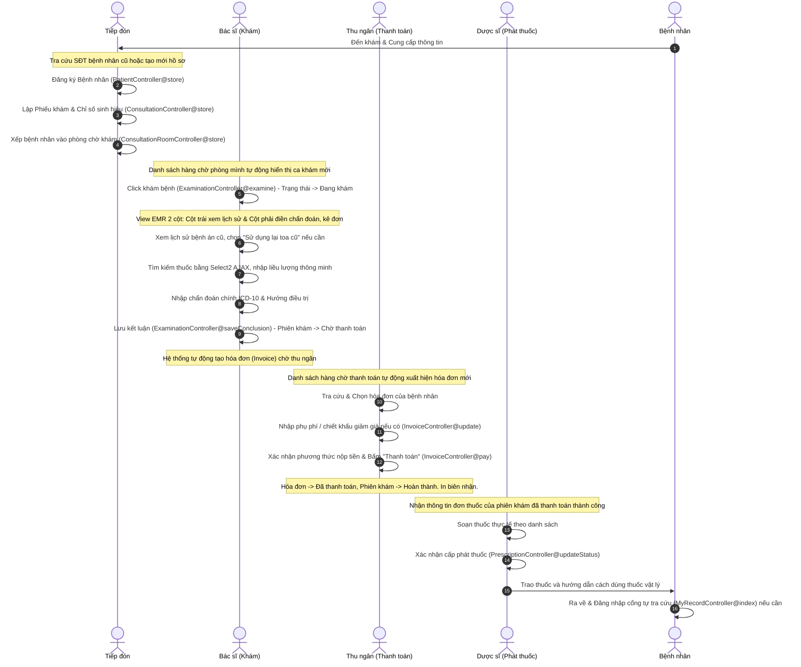

# AI_CONTEXT.md - Bản đồ Nghiệp vụ & Kỹ thuật Chi tiết Dự án QLPK (Cẩm nang Hướng dẫn Hệ thống)

Tài liệu này được biên soạn siêu chi tiết, đóng vai trò là **nguồn thông tin chuẩn duy nhất (Single Source of Truth)** về hệ thống **Quản lý Phòng khám (QLPK)**. Tài liệu này cung cấp đầy đủ thông tin về Cơ sở dữ liệu, Danh sách Routes, Sơ đồ Phân quyền (RBAC), Quy trình Nghiệp vụ từng bước, Tài khoản Demo và các giải pháp UI/UX Premium phục vụ trực tiếp cho việc biên soạn tài liệu hướng dẫn sử dụng (User Manual) và tài liệu kỹ thuật (Technical Docs).

---

# 1. Tổng quan Hệ thống & Các Phân hệ (System Modules)

Hệ thống QLPK được thiết kế để số hóa toàn diện hoạt động vận hành của một phòng khám đa khoa/chuyên khoa, tối ưu hóa quy trình từ lúc bệnh nhân bước vào tiếp đón cho đến khi khám xong, nhận thuốc và thanh toán ra về.

*   **Module Tiếp Đón (Reception):** Quản lý hồ sơ bệnh nhân, đăng ký mới, tiếp nhận thông tin sinh hiệu sơ bộ (nhiệt độ, huyết áp), tạo phiếu khám (Consultation) và phân bổ (xếp hàng chờ) vào các phòng khám chuyên khoa phù hợp.
*   **Phân hệ Bác sĩ / Khám bệnh lâm sàng (Electronic Medical Record - EMR):** Giao diện thông minh hai cột dành cho Bác sĩ. Hỗ trợ xem hồ sơ bệnh án lịch sử, nhập triệu chứng, chẩn đoán bệnh theo mã chuẩn quốc tế **ICD-10**, chỉ định cận lâm sàng và thực hiện kê đơn thuốc điện tử.
*   **Phân hệ Quản lý Dược (Pharmacy):** Quản lý danh mục thuốc đa cấp (Medicine và MedicineDetail), kiểm soát đơn giá bán theo các phiên bản cập nhật, quản lý xuất kho/cấp phát thuốc cho bệnh nhân dựa trên đơn thuốc đã hoàn thành thanh toán.
*   **Phân hệ Tài chính / Thu ngân (Billing & Cashier):** Tự động tổng hợp chi phí khám, phí cận lâm sàng và tiền thuốc từ phiên khám để lập hóa đơn (Invoice). Hỗ trợ áp dụng phụ phí, chiết khấu và ghi nhận thanh toán đa phương thức.
*   **Phân hệ Quản lý Nhân sự & Phân quyền (RBAC):** Quản lý danh sách nhân viên (Staff), liên kết tài khoản (Users), phân quyền vai trò (Roles) và các quyền chi tiết (Permissions), giám sát phân bổ vị trí làm việc (Room).
*   **Hệ thống Thông báo nội bộ (Internal Notification):** Gửi nhận thông báo thời gian thực giữa các phòng ban, đồng bộ hóa số lượng chưa đọc thông qua Blade SSR và cơ chế Polling AJAX tại Sidebar.

---

# 2. Kiến trúc Công nghệ (Tech Stack & Architecture)

*   **Backend:** **PHP 8.1+**, framework **Laravel 10** áp dụng mô hình kiến trúc MVC truyền thống nhưng phân tách lớp Route và Controller khoa học.
*   **Xác thực & Identity (IAM):** Tích hợp **Keycloak OIDC Client** (OpenID Connect) thông qua `KeycloakController` hỗ trợ **Single Sign-On (SSO)** và **Single Logout (SLO)**. Mật khẩu và tài khoản được quản lý tập trung ở Keycloak.
*   **Database:** **MySQL 8.0** kết hợp Eloquent ORM tối ưu quan hệ dữ liệu phức tạp.
*   **Frontend:**
    *   **Laravel Blade Template** (giao diện server-side rendering).
    *   **Bootstrap 5** (Layout Responsive).
    *   **Vite** (bundler tài nguyên tĩnh).
    *   **jQuery, Select2** (tìm kiếm tương tác AJAX thông minh cho Thuốc và ICD-10).
    *   **Google Fonts:** **Plus Jakarta Sans** mang lại giao diện hiện đại và thanh lịch.
    *   **CSS Premium chuyên dụng:** `public/css/custom-premium-style.css` định nghĩa hệ thống theme mềm mại, Soft Shadows, Glassmorphism nhẹ và các tối ưu Responsive trên Mobile.
*   **Containerization & DevOps:** **Laravel Sail** (Docker Compose) chứa các dịch vụ:
    *   `laravel.test` (PHP 8.2 / Nginx).
    *   `mysql` (Database).
    *   `redis` (Cache & Session).
    *   `mailpit` (Trình thu thập và kiểm thử Email).

---

# 3. Từ điển Dữ liệu & Database Schema Chi tiết

Hệ thống quản trị cơ sở dữ liệu quan hệ (RDBMS) gồm 24 bảng dữ liệu (tương ứng với 23 Eloquent Models và 1 bảng pivot `users_roles`) được thiết kế chuẩn hóa:

### 3.1. Bảng `users` (Tài khoản người dùng)
Quản lý thông tin xác thực và tài khoản đăng nhập của cả nhân viên phòng khám và bệnh nhân.
*   `id` (BigInt, Primary Key, Auto Increment)
*   `keycloak_sub` (Varchar 36, Unique, Nullable): UUID định danh chính từ Keycloak OIDC.
*   `username` (Varchar 255, Unique, Nullable): Tên đăng nhập (Keycloak là nguồn chính).
*   `password_hash` (Varchar 255, Nullable): Mật khẩu (Deprecated sau Keycloak).
*   `full_name` (Varchar 255): Họ và tên đầy đủ.
*   `email` (Varchar 255, Nullable, Unique)
*   `phone_number` (Varchar 255, Nullable): Số điện thoại liên lạc.
*   `address` (Text, Nullable): Địa chỉ liên hệ.
*   `national_id` (Varchar 255, Nullable): Số CCCD/CMND.
*   `avatar_url` (Varchar 255, Nullable): Link ảnh đại diện.
*   `last_login_at` (Datetime, Nullable): Thời gian đăng nhập cuối cùng.
*   `status` (TinyInt, Default: 1): Trạng thái hoạt động (`1`: Active, `0`: Blocked).
*   `created_at` & `updated_at` (Timestamp)

### 3.2. Bảng `roles` (Vai trò)
Định nghĩa các nhóm vai trò trong hệ thống (ADMIN, DOCTOR, CASHIER, RECEPTIONIST, PHARMACIST, PATIENT).
*   `id` (BigInt, Primary Key, Auto Increment)
*   `role_code` (Varchar 50, Unique): Mã vai trò (e.g. `ADMIN`, `DOCTOR`).
*   `role_name` (Varchar 100): Tên vai trò hiển thị trực quan.
*   `description` (Text, Nullable)
*   `status` (TinyInt, Default: 1)
*   `created_at` & `updated_at` (Timestamp)

### 3.3. Bảng pivot `users_roles` (Liên kết vai trò)
Liên kết nhiều-nhiều giữa người dùng và vai trò.
*   `user_id` (BigInt, Foreign Key liên kết `users.id`)
*   `role_id` (BigInt, Foreign Key liên kết `roles.id`)
*   `status` (TinyInt, Default: 1)

### 3.4. Bảng `roles_permission` (Quyền hạn chi tiết)
Quyền chi tiết gắn với từng vai trò phục vụ kiểm tra RBAC.
*   `id` (BigInt, Primary Key, Auto Increment)
*   `role_id` (BigInt, Foreign Key liên kết `roles.id`)
*   `permission` (Varchar 255): Tên mã quyền.
*   `status` (TinyInt, Default: 1)
*   `created_at` & `updated_at` (Timestamp)

### 3.5. Bảng `staff` (Nhân sự phòng khám)
Liên kết 1-1 với bảng `users` để định danh bác sĩ, điều dưỡng, thu ngân, quản trị viên.
*   `id` (BigInt, Primary Key, Auto Increment)
*   `user_id` (BigInt, Foreign Key liên kết `users.id`): Liên kết tài khoản.
*   `staff_code` (Varchar 50, Unique): Mã nhân viên (ví dụ: `BS001`, `TN002`).
*   `staff_type` (Varchar 50): Phân loại (`Doctor`, `Nurse`, `Cashier`, `Pharmacist`, `Admin`).
*   `full_name` (Varchar 255): Họ tên nhân viên.
*   `yob` (Integer, Nullable): Năm sinh.
*   `age` (Integer, Nullable): Tuổi.
*   `gender` (Varchar 10, Nullable): Giới tính.
*   `email` (Varchar 255, Nullable)
*   `phone_number` (Varchar 50, Nullable)
*   `address` (Text, Nullable)
*   `national_id` (Varchar 50, Nullable)
*   `academic_degree` (Varchar 100, Nullable): Học vị (Thạc sĩ, Tiến sĩ, Cử nhân...).
*   `specialty` (Varchar 255, Nullable): Chuyên khoa (Đa khoa, Nội khoa, Tai Mũi Họng...).
*   `medical_license` (Varchar 100, Nullable): Số chứng chỉ hành nghề (dành cho Bác sĩ).
*   `department_id` (BigInt, Foreign Key liên kết `department.id`): Thuộc Khoa nào.
*   `room_id` (BigInt, Foreign Key liên kết `room.id`, Nullable): Phòng làm việc/phòng khám được phân bổ.
*   `position` (Varchar 100, Nullable): Chức vụ (Trưởng khoa, Nhân viên...).
*   `career_start_year` (Integer, Nullable): Năm bắt đầu hành nghề.
*   `status` (TinyInt, Default: 1): Trạng thái hoạt động.
*   `created_at` & `updated_at` (Timestamp)

### 3.6. Bảng `patient` (Hồ sơ bệnh nhân)
Quản lý thông tin hành chính cốt lõi của người bệnh.
*   `id` (BigInt, Primary Key, Auto Increment)
*   `user_id` (BigInt, Foreign Key liên kết `users.id`, Nullable): Liên kết tài khoản cá nhân của bệnh nhân (nếu có để tự tra cứu lịch sử).
*   `patient_code` (Varchar 50, Unique): Mã định danh bệnh nhân (ví dụ: `BN2026001`).
*   `full_name` (Varchar 255): Họ và tên.
*   `gender` (Varchar 10): Giới tính (`Male` - Nam, `Female` - Nữ, `Other` - Khác).
*   `age` (Integer, Nullable): Tuổi hiện tại.
*   `email` (Varchar 255, Nullable)
*   `phone_number` (Varchar 50, Unique): Số điện thoại (dùng để tra cứu nhanh).
*   `address` (Text, Nullable): Địa chỉ thường trú.
*   `national_id` (Varchar 50, Nullable): CCCD/CMND.
*   `insurance_number` (Varchar 100, Nullable): Số thẻ BHYT.
*   `emergency_contact` (Varchar 255, Nullable): Số điện thoại người thân khi khẩn cấp.
*   `status` (TinyInt, Default: 1): Trạng thái hoạt động.
*   `created_at` & `updated_at` (Timestamp)

### 3.7. Bảng `department` (Khoa lâm sàng/cận lâm sàng)
*   `id` (BigInt, Primary Key, Auto Increment)
*   `dept_code` (Varchar 50, Unique): Mã khoa (e.g. `KLS`).
*   `dept_name` (Varchar 255): Tên khoa chuyên môn.
*   `description` (Text, Nullable)
*   `status` (TinyInt, Default: 1)
*   `created_at` & `updated_at` (Timestamp)

### 3.8. Bảng `room` (Phòng chức năng)
*   `id` (BigInt, Primary Key, Auto Increment)
*   `room_code` (Varchar 50, Unique): Mã phòng (e.g. `PK-SINGLE`).
*   `room_name` (Varchar 255): Tên phòng khám/phòng hành chính.
*   `room_type` (Varchar 50): Phân loại phòng (`Examination`, `Lab`, `Pharmacy`, `Emergency`, `Waiting`, `Administrative`).
*   `department_id` (BigInt, Foreign Key liên kết `department.id`): Thuộc Khoa nào.
*   `status` (TinyInt, Default: 1): Trạng thái (1: Hoạt động, 2: Đang sử dụng, 3: Bảo trì, 0: Đóng).
*   `created_at` & `updated_at` (Timestamp)

### 3.9. Bảng `room_detail` (Hạ tầng phòng khám)
Thông tin vật lý chi tiết của từng phòng ban.
*   `id` (BigInt, Primary Key, Auto Increment)
*   `room_id` (BigInt, Foreign Key liên kết `room.id` - Quan hệ 1-1)
*   `floor` (Integer): Số tầng đặt phòng.
*   `capacity` (Integer): Sức chứa người/giường bệnh tối đa.
*   `equipment_list` (Text, Nullable): Danh sách các thiết bị y khoa được trang bị.
*   `area_sqm` (Decimal 8,2): Diện tích phòng (m²).
*   `notes` (Text, Nullable)
*   `last_cleaned_at` (Datetime, Nullable)
*   `created_at` & `updated_at` (Timestamp)

### 3.10. Bảng `consultation` (Phiên khám bệnh - Thực thể trung tâm)
Trái tim của EMR, liên kết tất cả các tiến trình lâm sàng và tài chính của một lượt khám.
*   `id` (BigInt, Primary Key, Auto Increment)
*   `patient_id` (BigInt, Foreign Key liên kết `patient.id`): Bệnh nhân được khám.
*   `doctor_id` (BigInt, Foreign Key liên kết `staff.id`, Nullable): Bác sĩ đảm nhiệm kết luận khám.
*   `order_number` (Integer): Số thứ tự khám trong ngày.
*   `consultation_date` (Datetime): Ngày giờ thực hiện đăng ký/khám.
*   `chief_complaint` (Text, Nullable): Lý do vào viện.
*   `symptoms` (Text, Nullable): Triệu chứng lâm sàng ghi nhận ban đầu.
*   `temperature` (Decimal 3,1, Nullable): Nhiệt độ sinh hiệu.
*   `blood_pressure` (Varchar 50, Nullable): Huyết áp.
*   `diagnosis_code` (Varchar 15, Foreign Key liên kết `diagnosis.diagnosis_code`, Nullable): Mã chẩn đoán chính ICD-10.
*   `diagnosis_notes` (Text, Nullable): Mô tả chi tiết chẩn đoán của bác sĩ.
*   `follow_up_date` (Date, Nullable): Lịch hẹn tái khám.
*   `status` (TinyInt, Default: 0): Trạng thái phiên khám:
    *   `0` (`STATUS_NEW`): Mới tạo / Đăng ký.
    *   `1` (`STATUS_PENDING`): Chờ khám (trong phòng khám).
    *   `2` (`STATUS_PROCESSING`): Đang khám (Bác sĩ đang mở bệnh án).
    *   `3` (`STATUS_WAIT_PAYMENT`): Chờ thanh toán.
    *   `4` (`STATUS_COMPLETED`): Hoàn thành.
*   `created_at` & `updated_at` (Timestamp)

### 3.11. Bảng liên kết trung gian `consultation_room` (Xếp phòng chờ khám)
Mối quan hệ nhiều - nhiều giữa Phiên khám (`consultation`) và Phòng (`room`). Cho biết phiên khám đó đã/đang được xếp vào hàng đợi phòng nào.
*   `consultation_id` (BigInt, Foreign Key liên kết `consultation.id`)
*   `room_id` (BigInt, Foreign Key liên kết `room.id`)
*   `notes` (Text, Nullable): Ghi chú chuyển phòng.
*   `status` (TinyInt, Default: 1): Trạng thái hàng đợi (`1`: Chờ khám, `2`: Đang khám, `3`: Đã khám xong, `0`: Đã hủy).
*   `created_at` & `updated_at` (Timestamp)

### 3.12. Bảng `diagnosis` (Chuẩn mã bệnh ICD-10)
*   `id` (BigInt, Primary Key, Auto Increment)
*   `diagnosis_code` (Varchar 15, Unique): Mã bệnh viết chuẩn (ví dụ: `A09`, `J06.9`).
*   `diagnosis_name` (Varchar 255): Tên bệnh lý tiếng Việt.
*   `description` (Text, Nullable)
*   `icd_version` (Varchar 50): Phiên bản chuẩn ICD (e.g. `ICD-10`).
*   `status` (TinyInt, Default: 1)
*   `created_at` & `updated_at` (Timestamp)

### 3.13. Bảng `prescription` (Đơn thuốc điện tử)
*   `id` (BigInt, Primary Key, Auto Increment)
*   `consultation_id` (BigInt, Foreign Key liên kết `consultation.id`)
*   `prescribed_by` (BigInt, Foreign Key liên kết `staff.id`): Bác sĩ kê đơn.
*   `prescribed_at` (Datetime): Thời điểm kê đơn.
*   `doctor_advice` (Text, Nullable): Lời dặn dò chung của bác sĩ.
*   `dispensed_at` (Datetime, Nullable): Thời điểm dược sĩ cấp phát thuốc thực tế.
*   `dispensed_by` (BigInt, Foreign Key liên kết `staff.id`, Nullable): Dược sĩ thực hiện cấp thuốc.
*   `status` (TinyInt, Default: 0): Trạng thái đơn thuốc (`0`: Chờ phát, `1`: Đã cấp phát).
*   `created_at` & `updated_at` (Timestamp)

### 3.14. Bảng `prescription_detail` (Chi tiết đơn thuốc)
Chứa thông tin chi tiết từng loại thuốc được kê trong đơn thuốc.
*   `prescription_id` (BigInt, Foreign Key liên kết `prescription.id`)
*   `medicine_id` (BigInt, Foreign Key liên kết `medicine.id`)
*   `quantity` (Integer): Tổng số lượng thuốc được cấp.
*   `unit` (Varchar 50): Đơn vị tính (Viên, Gói, Chai...).
*   `duration_days` (Integer): Số ngày uống thuốc.
*   `dosage` (Varchar 255): Liều dùng hàng ngày chi tiết (ví dụ: `Sáng: 1, Chiều: 1`).
*   `usage_instructions` (Text, Nullable): Lời dặn chi tiết cách dùng.
*   `status` (TinyInt, Default: 1)
*   `created_at` & `updated_at` (Timestamp)

### 3.15. Bảng `medicine` (Danh mục thuốc gốc)
*   `id` (BigInt, Primary Key, Auto Increment)
*   `medicine_category_id` (BigInt, Foreign Key liên kết `medicine_category.id`): Nhóm dược lý.
*   `medicine_code` (Varchar 50, Unique): Mã thuốc nội bộ.
*   `medicine_name` (Varchar 255): Tên thương mại của thuốc.
*   `note` (Text, Nullable)
*   `status` (TinyInt, Default: 1)
*   `created_at` & `updated_at` (Timestamp)

### 3.16. Bảng `medicine_category` (Phân nhóm dược lý thuốc)
*   `id` (BigInt, Primary Key, Auto Increment)
*   `category_code` (Varchar 50, Unique): Mã nhóm thuốc (ví dụ: `KS`, `GT`).
*   `category_name` (Varchar 255): Tên nhóm thuốc (ví dụ: `Kháng sinh`, `Giảm đau`).
*   `description` (Text, Nullable)
*   `status` (TinyInt, Default: 1)
*   `created_at` & `updated_at` (Timestamp)

### 3.17. Bảng `medicine_detail` (Giá bán & Hoạt chất theo phiên bản)
Lưu trữ thông tin biến động giá bán và hàm lượng thuốc phục vụ cơ chế versioning giữ giá trị hóa đơn cũ.
*   `id` (BigInt, Primary Key, Auto Increment)
*   `medicine_id` (BigInt, Foreign Key liên kết `medicine.id`)
*   `order_number` (Integer): Số phiên bản giá thuốc.
*   `unit` (Varchar 50): Đơn vị tính tương ứng với giá bán.
*   `price` (Decimal 12,2): Giá bán hiện hành của phiên bản.
*   `active_ingredient` (Varchar 255): Tên hoạt chất chính và hàm lượng.
*   `storage_condition` (Varchar 255, Nullable): Điều kiện bảo quản thuốc.
*   `status` (TinyInt, Default: 1): Trạng thái (`1` là phiên bản giá đang có hiệu lực).
*   `created_at` & `updated_at` (Timestamp)

### 3.18. Bảng `prescription_template` (Toa thuốc mẫu cá nhân)
Danh sách đơn thuốc mẫu được các bác sĩ thiết lập sẵn để kê đơn nhanh.
*   `id` (BigInt, Primary Key, Auto Increment)
*   `template_name` (Varchar 255): Tên đơn thuốc mẫu.
*   `disease_name` (Varchar 255): Tên bệnh lâm sàng liên quan.
*   `diagnosis_code` (Varchar 15, Foreign Key liên kết `diagnosis.diagnosis_code`): Gắn với chẩn đoán ICD-10.
*   `doctor_id` (BigInt, Foreign Key liên kết `staff.id`): Bác sĩ tạo/sở hữu mẫu.
*   `description` (Text, Nullable)
*   `status` (TinyInt, Default: 1)
*   `created_at` & `updated_at` (Timestamp)

### 3.19. Bảng `prescription_template_detail` (Chi tiết toa thuốc mẫu)
*   `template_id` (BigInt, Foreign Key liên kết `prescription_template.id`)
*   `medicine_id` (BigInt, Foreign Key liên kết `medicine.id`)
*   `quantity` (Integer)
*   `unit` (Varchar 50)
*   `dosage` (Varchar 255)
*   `usage_instructions` (Text, Nullable)
*   `duration_days` (Integer)
*   `status` (TinyInt, Default: 1)
*   `created_at` & `updated_at` (Timestamp)

### 3.20. Bảng `invoice` (Hóa đơn thu phí tài chính)
Quản lý toàn bộ thông tin thanh toán của lượt khám.
*   `id` (BigInt, Primary Key, Auto Increment)
*   `invoice_code` (Varchar 50, Unique): Mã hóa đơn tự động chuẩn `HD-YYYYMMDD-XXXX`.
*   `consultation_id` (BigInt, Foreign Key liên kết `consultation.id`)
*   `invoice_date` (Datetime): Ngày tạo hóa đơn.
*   `consultation_fee` (Decimal 12,2): Phí khám bệnh lâm sàng gốc (mặc định: `100,000 VND`).
*   `lab_test_fee` (Decimal 12,2, Default: 0): Phí chỉ định xét nghiệm/cận lâm sàng.
*   `medicine_fee` (Decimal 12,2, Default: 0): Tổng tiền thuốc từ đơn thuốc.
*   `other_fee` (Decimal 12,2, Default: 0): Phụ phí phát sinh do thu ngân nhập thêm.
*   `discount` (Decimal 12,2, Default: 0): Tiền chiết khấu giảm giá.
*   `total_amount` (Decimal 12,2): Tổng tiền thực tế cần thanh toán.
*   `payment_method` (Varchar 50, Nullable): Tiền mặt, Thẻ, Chuyển khoản, Bảo hiểm.
*   `paid_at` (Datetime, Nullable): Ngày giờ nộp tiền thực tế.
*   `cashier_id` (BigInt, Foreign Key liên kết `staff.id`, Nullable): Thu ngân thực hiện thu.
*   `status` (TinyInt, Default: 0): Trạng thái (`0`: Chờ thanh toán, `1`: Đã thanh toán, `2`: Đã hủy).
*   `created_at` & `updated_at` (Timestamp)

### 3.21. Bảng `invoice_detail` (Chi tiết hóa đơn)
Phân rã các mục chi phí cụ thể in ra phiếu thu cho bệnh nhân.
*   `id` (BigInt, Primary Key, Auto Increment)
*   `invoice_id` (BigInt, Foreign Key liên kết `invoice.id`)
*   `item_type` (Varchar 50): Phân loại dịch vụ (`Consultation`, `Medicine`, `LabTest`, `Other`).
*   `item_name` (Varchar 255): Tên dịch vụ/tên thuốc cụ thể.
*   `reference_id` (BigInt): ID trỏ sang đối tượng gốc tương ứng.
*   `quantity` (Integer)
*   `unit_price` (Decimal 12,2)
*   `discount` (Decimal 12,2)
*   `line_total` (Decimal 12,2)
*   `notes` (Text, Nullable)
*   `status` (TinyInt, Default: 1)
*   `created_at` & `updated_at` (Timestamp)

### 3.22. Bảng `system_notification` (Thông báo hệ thống)
*   `id` (BigInt, Primary Key, Auto Increment)
*   `sender_id` (BigInt, Foreign Key liên kết `users.id`): Người gửi thông báo.
*   `target_type` (Varchar 50): Phạm vi gửi (`all` - Tất cả, `role` - Theo vai trò, `user` - Cá nhân).
*   `target_role` (Varchar 50, Nullable): Mã vai trò mục tiêu nếu gửi theo nhóm.
*   `target_user_id` (BigInt, Foreign Key liên kết `users.id`, Nullable): Người nhận nếu gửi cá nhân.
*   `title` (Varchar 255): Tiêu đề thông báo.
*   `content` (Text): Nội dung thông báo.
*   `notified_at` (Datetime): Thời điểm phát thông báo.
*   `expires_at` (Datetime, Nullable): Thời gian hết hạn của thông báo.
*   `status` (TinyInt, Default: 1)
*   `created_at` & `updated_at` (Timestamp)

### 3.23. Bảng `notification_reads` (Trạng thái đã đọc thông báo)
*   `notification_id` (BigInt, Foreign Key liên kết `system_notification.id`)
*   `user_id` (BigInt, Foreign Key liên kết `users.id`)
*   `read_at` (Datetime): Thời điểm click xem thông báo.

### 3.24. Bảng `system_setting` (Cấu hình phòng khám)
Thông tin hành chính phòng khám dùng hiển thị trên in ấn và biên nhận hóa đơn.
*   `id` (BigInt, Primary Key, Auto Increment)
*   `created_by` (BigInt, Foreign Key liên kết `users.id` - Admin thực hiện cấu hình)
*   `clinic_name` (Varchar 255): Tên phòng khám.
*   `phone_number` (Varchar 50): Số tổng đài liên hệ.
*   `email` (Varchar 255): Email liên hệ chính thức.
*   `address` (Text): Địa chỉ cơ sở.
*   `additional_info` (Text, Nullable): Chân trang biên nhận.
*   `logo_data` (MediumText, Nullable): Dữ liệu ảnh Logo Base64.
*   `status` (TinyInt, Default: 0): Trạng thái kích hoạt cấu hình (`1`: Active).
*   `created_at` & `updated_at` (Timestamp)

---

# 4. Phân Quyền Hệ Thống (RBAC Matrix)

Hệ thống kiểm soát truy cập nghiêm ngặt dựa trên vai trò người dùng (Role-Based Access Control) thông qua Custom Middleware `role:ROLE_CODE_1,ROLE_CODE_2...` kiểm tra trên trường liên kết trong bảng `users_roles`.

| Vai trò (Role Code) | Mô tả chi tiết | Phạm vi nghiệp vụ được cấp phép |
| :--- | :--- | :--- |
| **ADMIN** | Quản trị viên tối cao | Toàn quyền kiểm soát hệ thống. CRUD danh mục dùng chung (Mã bệnh ICD-10, Loại thuốc, Thuốc, Cấu hình phòng khám, Khoa, Phòng), quản lý tài khoản người dùng (khóa/mở, reset mật khẩu), xem Dashboard thống kê doanh thu và lượt khám toàn phòng khám. |
| **RECEPTIONIST** | Tiếp đón viên | Đăng ký hồ sơ hành chính bệnh nhân, tạo phiên khám lâm sàng ban đầu, xếp bệnh nhân vào hàng đợi của các phòng khám cụ thể. Xem thông tin lịch sử tiếp đón. |
| **DOCTOR** | Bác sĩ khám chữa bệnh | Xem danh sách chờ khám của phòng mình làm việc. Vào giao diện EMR khám bệnh: xem lịch sử bệnh án, chẩn đoán, kê đơn thuốc điện tử và chỉ định hẹn tái khám. Xem lịch sử khám toàn khoa. Quản lý toa thuốc mẫu cá nhân để kê đơn siêu tốc. |
| **CASHIER** | Nhân viên thu ngân | Tra cứu hóa đơn chờ thanh toán của bệnh nhân theo nhiều tiêu chí (Mã BN, SĐT). Điều chỉnh phụ phí, áp dụng chiết khấu và thực hiện thanh toán hóa đơn. In hóa đơn/phiếu thu tài chính. |
| **PHARMACIST** | Dược sĩ cấp phát | Tra cứu đơn thuốc của bệnh nhân đã hoàn thành thanh toán. Kiểm tra số lượng thực tế, thực hiện đóng gói và bấm xác nhận hoàn thành cấp phát thuốc vật lý cho bệnh nhân. |
| **PATIENT** | Bệnh nhân | Tự phục vụ: Đăng nhập xem hồ sơ sức khỏe cá nhân, danh sách các phiên khám đã thực hiện, chi tiết kết luận chẩn đoán của bác sĩ và hướng dẫn sử dụng đơn thuốc. |

---

# 5. Chi tiết Cấu trúc Thư mục Quan trọng

```text
qlpk/
├── app/
│   ├── Http/Controllers/
│   │   ├── Admin/                  # Nghiệp vụ quản lý của ADMIN & RECEPTIONIST
│   │   │   ├── ConsultationController.php    # Quản lý vòng đời phiên khám (CRUD Admin)
│   │   │   ├── ConsultationRoomController.php # Xếp hàng chờ buồng khám của bệnh nhân
│   │   │   ├── DashboardController.php       # Xem thống kê lượt khám, doanh thu ngày/tháng
│   │   │   ├── DepartmentController.php      # Quản lý danh mục các khoa y khoa
│   │   │   ├── DiagnosisController.php       # Quản lý danh mục mã bệnh chuẩn ICD-10 (Import Excel)
│   │   │   ├── MedicineCategoryController.php # Quản lý phân nhóm thuốc (Kháng sinh, giảm đau...)
│   │   │   ├── MedicineController.php        # CRUD Thuốc và các phiên bản giá bán
│   │   │   ├── PatientController.php         # Quản lý hồ sơ bệnh nhân hành chính
│   │   │   ├── PrescriptionController.php    # Quản lý và xem đơn thuốc toàn viện
│   │   │   ├── RoomController.php            # CRUD Phòng khám, phòng chức năng
│   │   │   ├── RoomDetailController.php      # Cấu hình giường bệnh, diện tích, thiết bị từng phòng
│   │   │   ├── StaffController.php           # Quản lý nhân sự y tế (Bác sĩ, Y tá, Thu ngân...)
│   │   │   ├── SystemSettingController.php   # Cấu hình tên, hotline, logo Base64 phòng khám
│   │   │   └── UserController.php            # Quản lý tài khoản, toggle khóa/mở, reset password
│   │   ├── Auth/                   # Xác thực bảo mật
│   │   │   └── KeycloakController.php        # Xử lý login, callback, SLO qua Keycloak OIDC
│   │   ├── Cashier/                # Xử lý tài chính
│   │   │   └── InvoiceController.php         # Thu ngân thanh toán, phụ phí, chiết khấu
│   │   ├── Doctor/                 # Lâm sàng cho Bác sĩ
│   │   │   ├── ExaminationController.php     # EMR khám bệnh, chẩn đoán, kê đơn, lịch sử khám
│   │   │   └── PrescriptionTemplateController.php # Tạo và áp dụng các toa thuốc mẫu cá nhân
│   │   ├── Patient/                # Cổng thông tin bệnh nhân
│   │   │   └── MyRecordController.php        # Tra cứu bệnh án cá nhân (Role PATIENT)
│   │   ├── Pharmacist/             # Phân hệ cấp phát thuốc
│   │   │   └── PrescriptionController.php    # Xác nhận đã phát thuốc vật lý cho bệnh nhân
│   │   ├── NotificationController.php        # Quản lý thông báo nội bộ, đếm AJAX chưa đọc
│   │   └── ProfileController.php             # Cập nhật thông tin cá nhân và đổi mật khẩu dùng chung
│   ├── Http/Middleware/
│   │   └── RoleMiddleware.php      # Middleware kiểm tra vai trò (RBAC) chặn truy cập
│   └── Models/                     # Eloquent Models & Database Schema
│       ├── User.php                # Thực thể tài khoản, kiểm tra hasRole() từ Keycloak session
│       ├── Role.php                # Vai trò hệ thống
│       ├── RolePermission.php      # Quyền hạn chi tiết
│       ├── Staff.php               # Nhân sự phòng khám, liên kết User, Room, Department
│       ├── Patient.php             # Bệnh nhân, scope tìm kiếm nhanh
│       ├── Department.php          # Khoa lâm sàng
│       ├── Room.php                # Phòng khám, phòng chức năng, phân loại buồng
│       ├── RoomDetail.php          # Hạ tầng vật lý, thiết bị y tế của phòng
│       ├── Consultation.php        # Thực thể trung tâm, vòng đời phiên khám bệnh
│       ├── ConsultationRoom.php    # Pivot hàng đợi xếp buồng khám
│       ├── Diagnosis.php           # Danh mục mã bệnh ICD-10
│       ├── Prescription.php        # Đơn thuốc điện tử, trạng thái cấp phát
│       ├── PrescriptionDetail.php  # Chi tiết thuốc, liều dùng uống
│       ├── PrescriptionTemplate.php # Đơn thuốc mẫu bác sĩ tự soạn
│       ├── PrescriptionTemplateDetail.php # Chi tiết thuốc mẫu
│       ├── Medicine.php            # Dược phẩm gốc
│       ├── MedicineCategory.php    # Phân nhóm dược lý thuốc
│       ├── MedicineDetail.php      # Phiên bản giá bán và hàm lượng hoạt chất của thuốc (Versioning)
│       ├── Invoice.php             # Hóa đơn thanh toán tài chính
│       ├── InvoiceDetail.php       # Phân rã chi tiết hóa đơn (biên nhận in ấn)
│       ├── SystemNotification.php  # Cấu hình gửi thông báo nội bộ
│       ├── NotificationRead.php    # Theo dõi trạng thái đã đọc thông báo của User
│       └── SystemSetting.php       # Thông tin liên hệ và Logo Base64 của phòng khám
```
├── database/
│   ├── migrations/                 # Lịch sử cấu trúc cơ sở dữ liệu MySQL
│   └── seeders/                    # Các kịch bản dữ liệu mẫu (Roles, Admin, Clinic duy nhất)
├── public/
│   ├── css/
│   │   └── custom-premium-style.css # File CSS Custom Premium chính (Theme, Border-radius, Responsive Table)
│   └── js/
│       └── prescription-form.js    # Tách biệt logic Javascript xử lý tương tác kê đơn thuốc thông minh tại view Doctor
├── resources/
│   ├── views/                      # Hệ thống giao diện hiển thị HTML/Blade
│   │   ├── auth/login.blade.php    # Trang đăng nhập thiết kế độc lập, tối ưu trải nghiệm
│   │   ├── layouts/app.blade.php   # Layout nền tảng (Responsive Sidebar, Mobile Offcanvas Sidebar Drawer)
│   │   ├── partials/sidebar.blade.php # Sidebar thông minh tích hợp ajaxUnreadCount đếm thông báo
│   │   ├── doctor/                 # Giao diện của Bác sĩ (Khám bệnh lâm sàng, Lịch sử của tôi)
│   │   ├── invoices/               # Giao diện của Thu ngân (Danh sách, Chỉnh sửa hóa đơn, Biên nhận in ấn)
│   │   └── welcome.blade.php       # Trang giới thiệu / Chuyển hướng tự động
└── routes/                         # Quản lý định tuyến chia tách theo Phân hệ
    ├── web.php                     # Route dùng chung (Auth, Profile, Notification)
    ├── admin.php                   # Hàng loạt route nghiệp vụ CRUD cấu hình cho ADMIN & RECEPTIONIST
    ├── doctor.php                  # Hàng loạt route chuyên môn của DOCTOR (My-consultations, Examine, Templates)
    ├── cashier.php                 # Nhóm route xử lý tiền nong của CASHIER
    ├── pharmacist.php              # Route xác nhận cấp phát thuốc của PHARMACIST
    └── patient.php                 # Cổng xem bệnh án cá nhân của PATIENT
```

---

# 6. Danh mục Routes & Các Endpoint Nghiệp vụ Chi tiết

Dưới đây là bảng tra cứu toàn bộ danh sách routes trong hệ thống phục vụ việc liên kết kiểm tra phân quyền và ánh xạ các màn hình chức năng:

### 6.1. Routes Dùng Chung (Shared Web Routes - `routes/web.php`)
Các tuyến đường này yêu cầu đăng nhập chung (ngoại trừ các route login) và phục vụ cho tất cả các tài khoản nhân viên.

*   `GET /` `->` Tự động chuyển hướng về trang đăng nhập `/login`.
*   `GET /login` `->` Trang đăng nhập trung gian (Hiển thị nút Đăng nhập qua Keycloak).
*   `GET /auth/redirect` `[KeycloakController@redirect]` `->` Điều hướng sang trang đăng nhập Keycloak OIDC.
*   `GET /auth/callback` `[KeycloakController@callback]` `->` Tiếp nhận callback OIDC từ Keycloak, xác thực, lưu token/roles vào session.
*   `POST /auth/logout` & `GET /auth/logout` `[KeycloakController@logout]` `->` Đăng xuất tài khoản (Single Logout).
*   `GET /home` `[HomeController@index]` `->` Trang chủ điều phối chung sau đăng nhập.
*   `GET /profile` `[ProfileController@index]` `->` Xem thông tin tài khoản cá nhân.
*   `POST /profile/update` `[ProfileController@update]` `->` Cập nhật thông tin tài khoản.
*   `GET /profile/change-password` `[ProfileController@changePassword]` `->` Chuyển hướng đến Keycloak Account Console để đổi mật khẩu.
*   `GET /notifications` `[NotificationController@index]` `->` Danh sách thông báo nhận được.
*   `GET /notifications/create` `[NotificationController@create]` `->` Soạn thông báo mới (Chỉ dành cho nhân viên).
*   `POST /notifications` `[NotificationController@store]` `->` Gửi thông báo đến đối tượng chỉ định.
*   `GET /notifications/{id}` `[NotificationController@show]` `->` Đọc chi tiết thông báo (Đánh dấu đã đọc).
*   `DELETE /notifications/{id}` `[NotificationController@destroy]` `->` Xóa thông báo khỏi danh sách.
*   `GET /notifications/ajax/unread-count` `[NotificationController@ajaxUnreadCount]` `->` Endpoint AJAX trả về số lượng thông báo chưa đọc dạng JSON.

---

### 6.2. Routes Tiếp Đón & Quản Trị Hệ Thống (`routes/admin.php`)
Được bảo vệ bởi các Middleware tương ứng theo RBAC.

#### A. Quyền của Tiếp Đón viên & Admin (`role:ADMIN,RECEPTIONIST`):
*   `GET /patients` `[PatientController@index]` `->` Danh sách hồ sơ bệnh nhân.
*   `GET /patients/create` `[PatientController@create]` `->` Giao diện tạo mới hồ sơ bệnh nhân.
*   `POST /patients` `[PatientController@store]` `->` Lưu hồ sơ bệnh nhân mới.
*   `GET /patients/{id}` `[PatientController@show]` `->` Xem chi tiết hồ sơ bệnh nhân.
*   `GET /patients/{id}/edit` `[PatientController@edit]` `->` Giao diện sửa hồ sơ bệnh nhân.
*   `PUT /patients/{id}` `[PatientController@update]` `->` Cập nhật hồ sơ bệnh nhân.
*   `DELETE /patients/{id}` `[PatientController@destroy]` `->` Xóa hồ sơ bệnh nhân.
*   `GET /patients/search` `[PatientController@search]` `->` Tìm kiếm bệnh nhân theo từ khóa (Mã BN, Họ Tên, SĐT).
*   `GET /patients/ajax/search` `[PatientController@ajaxSearch]` `->` AJAX tìm kiếm bệnh nhân phục vụ auto-complete.
*   `GET /consultations` `[ConsultationController@index]` `->` Danh sách các phiên khám toàn diện.
*   `GET /consultations/create` `[ConsultationController@create]` `->` Tạo mới phiên khám (đo chỉ số sinh hiệu: nhiệt độ, huyết áp).
*   `POST /consultations` `[ConsultationController@store]` `->` Lưu phiên khám mới.
*   `GET /consultations/{id}/edit` `[ConsultationController@edit]` `->` Sửa thông tin hành chính/sinh hiệu của phiên khám.
*   `PUT /consultations/{id}` `[ConsultationController@update]` `->` Cập nhật thông tin phiên khám.
*   `DELETE /consultations/{id}` `[ConsultationController@destroy]` `->` Hủy/xóa phiên khám (chỉ khi chưa khám).
*   `GET /consultations/ajax/search` `[ConsultationController@ajaxSearch]` `->` AJAX tìm kiếm phiên khám.
*   `GET /consultation-rooms` `[ConsultationRoomController@index]` `->` Danh sách xếp phòng khám.
*   `GET /consultation-rooms/create` `[ConsultationRoomController@create]` `->` Giao diện phân buồng khám.
*   `POST /consultation-rooms` `[ConsultationRoomController@store]` `->` Xếp bệnh nhân vào phòng chờ khám (`consultation_room`).
*   `GET /consultation-rooms/{consultation_id}/{room_id}` `[ConsultationRoomController@show]` `->` Xem chi tiết xếp phòng.
*   `GET /consultation-rooms/{consultation_id}/{room_id}/edit` `[ConsultationRoomController@edit]` `->` Sửa buồng khám.
*   `PUT /consultation-rooms/{consultation_id}/{room_id}` `[ConsultationRoomController@update]` `->` Cập nhật buồng khám.
*   `DELETE /consultation-rooms/{consultation_id}/{room_id}` `[ConsultationRoomController@destroy]` `->` Rút bệnh nhân khỏi hàng chờ phòng khám.

#### B. Quyền Hạn Tối Cao của Admin (`role:ADMIN`):
*   `GET /dashboard` `[DashboardController@index]` `->` Trang tổng quan số liệu thống kê.
*   `GET /dashboard/stats` `[DashboardController@getStats]` `->` Trả về JSON thống kê lượt khám, doanh thu phục vụ vẽ biểu đồ.
*   `GET /diagnoses/import` & `POST /diagnoses/import` `->` Nhập danh sách mã bệnh ICD-10 từ file Excel.
*   `GET /diagnoses/import/template` `->` Tải file Excel mẫu chẩn đoán ICD-10.
*   `GET /diagnoses/create` & `POST /diagnoses` `->` CRUD mã bệnh ICD-10 thủ công.
*   `PUT /diagnoses/{id}` & `DELETE /diagnoses/{id}` `->` Chỉnh sửa, xóa mã chẩn đoán.
*   `GET /departments` `[DepartmentController@index]` `->` Quản lý danh sách các khoa chuyên môn.
*   `GET /departments/create` & `POST /departments` `->` CRUD khoa chuyên môn mới.
*   `GET /departments/ajax/search` `->` AJAX tìm kiếm khoa.
*   `GET /departments/{id}` `[DepartmentController@show]` `->` Xem thông tin khoa.
*   `GET /departments/{id}/edit` & `PUT /departments/{id}` `->` Sửa khoa chuyên môn.
*   `DELETE /departments/{id}` `->` Xóa khoa.
*   `GET /rooms` `[RoomController@index]` `->` Danh sách phòng ban chức năng.
*   `GET /rooms/create` & `POST /rooms` `->` CRUD phòng ban mới.
*   `GET /rooms/ajax/search` `->` AJAX tìm kiếm phòng.
*   `GET /rooms/{id}` `[RoomController@show]` `->` Xem chi tiết phòng.
*   `GET /rooms/{id}/edit` & `PUT /rooms/{id}` `->` Sửa phòng.
*   `DELETE /rooms/{id}` `->` Xóa phòng.
*   `GET /room-details/ajax/search` `->` AJAX tìm kiếm chi tiết phòng.
*   `GET /room-details` `->` Resource route quản lý cấu hình vật lý giường/thiết bị của phòng.
*   `GET /staff` `[StaffController@index]` `->` Quản lý danh sách nhân sự (Bác sĩ, Y tá, Thu ngân, Dược sĩ).
*   `GET /staff/ajax/search` `->` AJAX tìm kiếm nhân viên.
*   `GET /staff/create` & `POST /staff` `->` CRUD nhân viên mới, liên kết tài khoản `users`.
*   `GET /staff/{id}/edit` & `PUT /staff/{id}` `-> Chỉnh sửa thông tin nhân viên.
*   `DELETE /staff/{id}` `->` Xóa nhân viên.
*   `GET /medicine-categories` `[MedicineCategoryController@index]` `->` Danh sách nhóm thuốc dược lý.
*   `GET /medicine-categories/import` & `POST /medicine-categories/import` `->` Import Excel danh mục nhóm thuốc.
*   `GET /medicine-categories/merge` & `POST /medicine-categories/merge` `->` Trộn nhóm thuốc bị trùng lặp.
*   `GET /medicine-categories/create` & `POST /medicine-categories` `->` CRUD nhóm thuốc thủ công.
*   `DELETE /medicine-categories/{id}` `->` Xóa nhóm thuốc.
*   `GET /medicines` `[MedicineController@index]` `->` Quản lý danh mục thuốc toàn phòng khám.
*   `GET /medicines/import` & `POST /medicines/import` `->` Import Excel danh mục thuốc gốc.
*   `GET /medicines/create` & `POST /medicines` `->` Tạo thuốc gốc mới.
*   `POST /medicines/{id}/details` `[MedicineController@storeDetail]` `->` Cập nhật đơn giá bán và hoạt chất mới cho thuốc (Versioning).
*   `GET /medicines/details/{detail_id}/edit` & `PUT /medicines/details/{detail_id}` `->` Sửa phiên bản giá thuốc.
*   `DELETE /medicines/details/{detail_id}` `->` Xóa phiên bản giá thuốc.
*   `GET /users` `[UserController@index]` `->` Quản lý danh sách tài khoản toàn viện.
*   `GET /users/ajax/search` `->` AJAX tìm kiếm tài khoản.
*   `PATCH /users/{id}/toggle-status` `[UserController@toggleStatus]` `->` Khóa hoặc mở tài khoản.
*   `POST /users/{id}/reset-password` `[UserController@resetPassword]` `->` Đặt lại mật khẩu mặc định nhanh chóng.
*   `GET /settings` `[SystemSettingController@index]` `->` Cấu hình thông tin liên hệ và Logo Base64 của phòng khám.
*   `POST /settings` & `PUT /settings/{id}` `->` CRUD thông tin cấu hình phòng khám.
*   `DELETE /settings/{id}/logo` `[SystemSettingController@removeLogo]` `->` Xóa Logo Base64 khỏi cấu hình.

#### C. Quyền xem Danh mục dùng chung (`role:ADMIN,DOCTOR,PHARMACIST`):
*   `GET /prescriptions` `[PrescriptionController@index]` `->` Xem lịch sử đơn thuốc toàn viện.
*   `GET /prescriptions/{id}/show` `[PrescriptionController@show]` `->` Xem chi tiết đơn thuốc.
*   `GET /diagnoses` `[DiagnosisController@index]` `->` Tra cứu danh sách mã bệnh ICD-10.
*   `GET /medicine-categories/ajax/search` `->` AJAX tìm kiếm nhanh nhóm thuốc.
*   `GET /medicines/ajax/search` `->` AJAX Select2 tìm kiếm nhanh thuốc.
*   `GET /diagnoses/ajax/search` `->` AJAX Select2 tìm kiếm nhanh mã/tên bệnh ICD-10.

---

### 6.3. Routes Nghiệp Vụ Lâm Sàng của Bác Sĩ (`routes/doctor.php`)
Được bảo vệ nghiêm ngặt bởi Middleware `role:DOCTOR`.

*   `GET /consultations/doctor/my-consultations` `[ExaminationController@index]` `->` Danh sách bệnh nhân đang chờ tại phòng khám được phân bổ của bác sĩ hiện tại.
*   `GET /consultations/doctor/ajax/search` `[ExaminationController@ajaxSearch]` `->` AJAX tìm kiếm bệnh nhân trong hàng chờ khám.
*   `GET /consultations/doctor/{id}/examine` `[ExaminationController@examine]` `->` Giao diện Khám bệnh EMR lâm sàng 2 cột. (Đổi trạng thái Consultation sang `STATUS_PROCESSING`).
*   `PUT /doctor/consultations/{id}/conclusion` `[ExaminationController@saveConclusion]` `->` Lưu kết luận chẩn đoán ICD-10 của bác sĩ. (Đổi trạng thái Consultation sang `STATUS_WAIT_PAYMENT`).
*   `POST /doctor/consultations/{id}/save-examination` `[ExaminationController@saveExamination]` `->` Lưu tổng hợp kết luận khám và kê đơn thuốc trong một DB Transaction.
*   `GET /doctor/my-history` `[ExaminationController@myHistory]` `->` Lịch sử các ca khám bác sĩ hiện tại đã thực hiện.
*   `GET /my-clinic` `[ExaminationController@myRoomPatients]` `->` Xem danh sách bệnh nhân buồng khám hiện tại.
*   `GET /templates` `[PrescriptionTemplateController@index]` `->` Danh sách các Toa thuốc mẫu.
*   `POST /templates/from-prescription/{id}` `[PrescriptionTemplateController@storeFromPrescription]` `->` Tạo toa thuốc mẫu từ đơn thuốc thực tế vừa kê.
*   `POST /templates` & `PUT /templates/{id}` `->` CRUD toa thuốc mẫu cá nhân.

---

### 6.4. Routes Nghiệp Vụ Thu Ngân (`routes/cashier.php`)
Được bảo vệ bởi Middleware `role:ADMIN,CASHIER`.

*   `GET /invoices` `[InvoiceController@index]` `->` Màn hình hàng chờ thanh toán (hóa đơn `STATUS_PENDING`) và lịch sử hóa đơn.
*   `GET /invoices/ajax/pending` `[InvoiceController@ajaxPending]` `->` AJAX cập nhật hàng chờ đóng tiền tự động.
*   `GET /invoices/{id}/edit` `[InvoiceController@edit]` `->` Sửa hóa đơn (cho phép thu ngân nhập thêm Phụ phí `other_fee` hoặc Chiết khấu `discount`).
*   `PUT /invoices/{id}` `[InvoiceController@update]` `->` Cập nhật giá trị hóa đơn và tính toán lại tổng tiền thực thu.
*   `GET /invoices/{id}/show` `[InvoiceController@show]` `->` Biên nhận tài chính in ấn (ẩn header/sidebar khi in).
*   `PUT /invoices/{id}/pay` `[InvoiceController@pay]` `->` Xác nhận thanh toán hóa đơn. Hóa đơn chuyển sang `STATUS_PAID` và Consultation liên quan chuyển sang `STATUS_COMPLETED`.

---

### 6.5. Routes Nghiệp Vụ Cấp Phát Thuốc (`routes/pharmacist.php`)
Được bảo vệ bởi Middleware `role:ADMIN,PHARMACIST`.

*   `PATCH /prescriptions/{id}/status` `[PrescriptionController@updateStatus]` `->` Dược sĩ xác nhận cấp phát thuốc vật lý. Đơn thuốc chuyển trạng thái từ Chờ phát sang Đã phát, cập nhật thời điểm phát `dispensed_at` và người phát `dispensed_by`.

---

### 6.6. Routes Cổng Thông Tin Bệnh Nhân (`routes/patient.php`)
Được bảo vệ bởi Middleware `role:PATIENT`.

*   `GET /my-medical-record` `[MyRecordController@index]` `->` Cổng thông tin cho bệnh nhân tự đăng nhập xem toàn bộ lịch sử bệnh án, chẩn đoán của bác sĩ và hướng dẫn sử dụng đơn thuốc.

---

# 7. Quy trình Nghiệp vụ Thực tế từng bước (End-to-End Business Flow)

Quy trình chuẩn hóa hoạt động của phòng khám được thực hiện tuần tự qua các vai trò nhân viên:



### 7.1. Chi tiết Hành động Nghiệp vụ:
1.  **Bước 1: Tiếp đón & Phân buồng khám**
    *   Tiếp đón viên dùng giao diện `patients/create` nhập Họ tên, SĐT, Giới tính, Tuổi, Thẻ BHYT (nếu có).
    *   Tạo phiếu khám mới (`consultations/create`), đo nhanh Nhiệt độ (ví dụ: `37.2` độ C), Huyết áp (`120/80 mmHg`), nhập lý do khám ("Đau họng kèm ho khan").
    *   Chọn phòng khám mục tiêu trong danh sách (ví dụ: "Phòng Khám Duy Nhất"). Bản ghi trong bảng `consultation_room` được ghi nhận trạng thái chờ. Bệnh nhân nhận số thứ tự khám `order_number`.
2.  **Bước 2: Lâm sàng & Kê đơn thuốc tại buồng Bác sĩ**
    *   Bác sĩ thấy bệnh nhân có số thứ tự trong hàng chờ tại màn hình `/consultations/doctor/my-consultations`, nhấn "Khám bệnh". Hệ thống ngay lập tức chuyển trạng thái phiên khám sang `2` (`Đang khám`) để tránh các bác sĩ khác mở trùng.
    *   **Giao diện EMR thông minh (View 2 cột):**
        *   **Cột bên trái:**
            *   Hiển thị thông tin hành chính bệnh nhân gọn gàng. Trên thiết bị di động, phần thông tin này tự động co lại trong Accordion thu gọn (`#leftColumnCollapse`) để tiết kiệm không gian làm việc.
            *   Lịch sử khám bệnh gồm **2 tab**:
                *   *Tab "Lịch sử BN":* Danh sách toàn bộ các phiên khám cũ của bệnh nhân ở mọi phòng ban kèm chi tiết chẩn đoán, đơn thuốc đã kê.
                *   *Tab "Lịch sử của tôi":* Các ca bệnh mà chính bác sĩ này đã khám trong quá khứ để tham chiếu thói quen kê đơn.
            *   **Tái sử dụng đơn thuốc:** Bác sĩ bấm vào một "Phiếu khám cũ #xxx" -> Hệ thống chuyển hướng mượt mà sang giao diện xem chi tiết `consultations/show.blade.php?reuse_mode=1` ngay tại tab hiện hành. Bác sĩ bấm nút **"Sử dụng lại toa thuốc"**, hệ thống đóng gói danh sách thuốc kèm lời dặn lưu tạm vào `localStorage['reuse_prescription_data']` rồi tự động quay lại buồng khám cũ. Form kê đơn tự động phát hiện dữ liệu tạm này, tự động điền đầy đủ thuốc và liều lượng rồi cuộn màn hình xuống vùng kê đơn cho bác sĩ. Dữ liệu tạm tự hủy ngay sau khi áp dụng hoặc sau 5 phút để bảo mật.
        *   **Cột bên phải:**
            *   Form kết luận chuyên môn: Nhập triệu chứng thực tế, ghi chú chẩn đoán. Ô tìm kiếm mã ICD-10 sử dụng Select2 tìm theo mã hoặc tên bệnh siêu nhanh.
            *   Form kê đơn thuốc điện tử: Thiết kế compact tối giản 1 dòng/thuốc. Khi gõ tìm kiếm thuốc bằng Select2, hệ thống tự động lọc theo Nhóm thuốc đã chọn. Bác sĩ nhập liều dùng riêng biệt theo 4 buổi sáng, trưa, chiều, tối và số ngày dùng -> Hệ thống tự động nhân số lượng để điền vào tổng số lượng thuốc cấp phát. Nút bấm chọn nhanh thời điểm uống (Trước ăn, Trong ăn, Sau ăn) giúp bác sĩ không phải gõ tay.
            *   *Tính năng Auto-fill rảnh tay:* Khi bác sĩ bấm nút "Thêm dòng thuốc tiếp theo", hệ thống tự động sao chép nhóm thuốc và số ngày dùng từ dòng liền trước, giúp bác sĩ kê đơn hàng loạt cực nhanh.
    *   Bác sĩ nhấn **"Lưu Kết Luận"**. Phiên khám lưu thông tin bác sĩ thực hiện khám (`doctor_id`) và tự động chuyển trạng thái thành `3` (`Chờ thanh toán`). Hệ thống đồng thời tính toán tổng tiền thuốc và tạo một hóa đơn `Invoice` ở trạng thái chờ tương ứng.
3.  **Bước 3: Điều chỉnh tài chính & Thu tiền tại quầy Thu ngân**
    *   Thu ngân mở màn hình `/invoices`, thấy bệnh nhân vừa khám xong xuất hiện ở hàng đợi Chờ thanh toán. Click chọn hóa đơn.
    *   Xem chi tiết các khoản phí: Tiền khám gốc (`100,000 VND`), tiền thuốc do bác sĩ kê đơn tự động tổng hợp.
    *   Nếu có chi phí phát sinh ngoài (ví dụ: tiền băng gạc, tiền dụng cụ hỗ trợ), thu ngân bấm nút "Chỉnh sửa hóa đơn" để thêm Phụ phí khác (`other_fee`) kèm ghi chú rõ ràng, hoặc áp dụng Chiết khấu giảm giá (`discount`) nếu bệnh nhân có thẻ ưu đãi. Hệ thống sử dụng DB Transaction tính toán lại chính xác tổng tiền thực thu.
    *   Bấm **"Xác nhận Thanh toán"** và chọn phương thức đóng tiền (ví dụ: `Transfer` - Chuyển khoản ngân hàng). Hệ thống cập nhật hóa đơn thành Đã thanh toán (`paid_at` cập nhật thời gian thực, `cashier_id` ghi nhận thu ngân thu tiền). Phiên khám liên quan tự động chuyển sang trạng thái cuối cùng `4` (`Hoàn thành`).
    *   In biên nhận tài chính trao cho bệnh nhân. Giao diện in ấn sạch đẹp, ẩn toàn bộ sidebar/header của phần mềm để tiết kiệm giấy và giữ tính thẩm mỹ.
4.  **Bước 4: Cấp phát thuốc thực tế**
    *   Dược sĩ phòng dược thấy đơn thuốc của bệnh nhân đã hoàn thành thanh toán trên phần mềm.
    *   Thực hiện soạn thuốc vật lý theo danh mục, liều lượng ghi trên đơn.
    *   Nhấp **"Xác nhận Cấp thuốc"** trên màn hình để chuyển đơn thuốc sang trạng thái Đã phát, hệ thống ghi nhận thời điểm phát thuốc thực tế. Dược sĩ trao thuốc kèm lời dặn hướng dẫn sử dụng. Bệnh nhân hoàn thành quy trình khám chữa bệnh tại phòng khám.

---

# 8. Hướng dẫn Thiết lập Ban đầu & Tài khoản Thử nghiệm (Initial Setup)

Để triển khai nhanh hệ thống phục vụ việc trình diễn hoặc viết hướng dẫn sử dụng, hãy sử dụng các tài khoản mẫu được cấu hình sẵn trong Seeders:

### 8.1. Các lệnh khởi tạo môi trường (Laravel Sail):
```bash
# 1. Khởi động các container Docker ở chế độ chạy nền
./vendor/bin/sail up -d

# 2. Cài đặt các thư viện frontend
./vendor/bin/sail npm install

# 3. Biên dịch tài nguyên tĩnh (Vite)
./vendor/bin/sail npm run dev

# 4. Chạy Migrations kèm kịch bản Seed dữ liệu mẫu đầy đủ
./vendor/bin/sail artisan migrate:fresh --seed

# 5. Chạy Seeder cấu hình phòng khám đơn (Single Doctor Clinic) chuyên dụng
./vendor/bin/sail artisan db:seed --class=SingleDoctorClinicSeeder
```

### 8.2. Danh sách Tài khoản Đăng nhập Mẫu (Thử nghiệm hệ thống):

Hệ thống cung cấp sẵn các tài khoản với phân quyền tương ứng để kiểm thử từng quy trình nghiệp vụ:

| Tên Đăng Nhập (Username) | Mật khẩu Mẫu | Vai trò được gán (Role) | Mô tả & Phòng khám Phân bổ |
| :--- | :--- | :--- | :--- |
| **`bacsi_admin`** | **`123456`** | **DOCTOR, ADMIN** | Tài khoản đặc quyền kép. Vừa có quyền quản trị tối cao của Admin để cấu hình hệ thống, vừa được gán vai trò Bác sĩ, làm việc tại phòng khám duy nhất **`Phòng Khám Duy Nhất` (PK-SINGLE)** thuộc khoa lâm sàng **`Khoa Lâm Sàng` (KLS)**. Thích hợp để demo trọn gói nhanh. |
| **`admin_demo`** | **`123456`** | **ADMIN** | Quản trị viên tối cao của hệ thống. Dùng để quản lý nhân viên, cấu hình phòng, import danh mục thuốc và xem dashboard doanh thu. |
| **`benhnhan_demo`** | **`123456`** | **PATIENT** | Bệnh nhân mẫu **Nguyễn Văn Bệnh Nhân** (Mã BN: `BN2026001`). Dùng để đăng nhập Cổng thông tin bệnh nhân xem lịch sử bệnh án. |

---

# 9. Giải pháp UI/UX Premium & Thiết kế Responsive trên Thiết bị Di động

Giao diện hệ thống được chăm chút tỉ mỉ, mang phong cách thiết kế cao cấp (Premium UI/UX) và tối ưu hóa tối đa cho các thiết bị di động, tablet màn hình nhỏ:

1.  **Hệ thống Theme Premium mềm mại:**
    *   Sử dụng màu nền xám nhẹ, các khối chức năng bo góc bo cong lớn (`12px` - `16px`) tạo cảm giác hiện đại, sang trọng.
    *   Đổ bóng mềm (Soft Shadows) phân tách chiều sâu các lớp giao diện.
    *   Tích hợp font chữ thời thượng **Plus Jakarta Sans** cho nét chữ thanh mảnh, dễ đọc dưới ánh sáng phòng khám.
2.  **Layout Responsive thông minh vượt trội:**
    *   *Desktop (>= 992px):* Sidebar điều hướng cố định bên trái giúp nhân viên thao tác một chạm nhanh chóng giữa các chức năng.
    *   *Mobile & Tablet (< 992px):* Sidebar tự động chuyển đổi thành dạng Hamburger Offcanvas Drawer (Ngăn kéo vuốt từ cạnh trái màn hình), giúp giải phóng toàn bộ không gian hiển thị cho bảng dữ liệu và form kê đơn.
3.  **Tối ưu hóa Bảng biểu chống vỡ chữ (No-wrap Table):**
    *   Tại các bảng danh sách bệnh nhân hoặc hóa đơn, để tránh hiện tượng chữ bị trình duyệt tự ý bóp nghẹt xuống dòng làm méo mó các nút hành động, hệ thống áp dụng thuộc tính `white-space: nowrap !important` cho các cột.
    *   Kết hợp bao bọc bảng trong container `.table-responsive` hỗ trợ thuộc tính cuộn ngang mượt mà (`overflow-x: auto`), bổ sung thanh cuộn Scrollbar màu Indigo nổi bật để người dùng vuốt kéo bằng ngón tay cực kỳ trơn tru trên màn hình cảm ứng di động.
4.  **Kê đơn dạng thẻ dọc thông minh (Mini-card Mobile Prescription):**
    *   Phần lưới kê đơn thuốc trên máy tính hiển thị dạng hàng ngang dài. Khi chuyển sang màn hình di động, hệ thống tự động biên dịch linh hoạt cấu trúc dòng thành các **Thẻ Mini Card** xếp dọc độc lập, giúp bác sĩ dễ dàng chạm bấm, hiệu chỉnh liều lượng bằng ngón tay một cách trực quan mà không bị lệch dòng.
5.  **Giải pháp chống trễ chấm đỏ thông báo (AJAX & Blade SSR Synchronized):**
    *   Để triệt tiêu hiện tượng giật/trễ/nhấp nháy giao diện khi trang tải xong mới chạy AJAX đếm thông báo, hệ thống áp dụng cơ chế kết hợp:
        *   Khi tải trang, số lượng thông báo chưa đọc được tính toán trực tiếp từ server và render ngay tại Sidebar (Server-side rendering qua Blade), chấm đỏ hiển thị tức thì.
        *   Trong quá trình nhân viên làm việc, một luồng polling AJAX tự động ngầm kích hoạt mỗi **60 giây** để cập nhật số lượng thông báo mới phát sinh trong phiên mà không cần tải lại trang.
        *   Khi click đọc chi tiết thông báo, AJAX lập tức cập nhật giảm số lượng hiển thị và ẩn chấm đỏ ngay lập tức tại Sidebar giúp trải nghiệm liền mạch tuyệt đối.

---
*Lưu ý hướng dẫn viết tài liệu: Khi viết hướng dẫn cho người dùng cuối, hãy chụp ảnh màn hình giao diện thực tế tại các buồng khám (Doctor Examine), màn hình thanh toán (Invoice Show) và biên nhận in ấn để tăng tính trực quan cho tài liệu hướng dẫn.*
