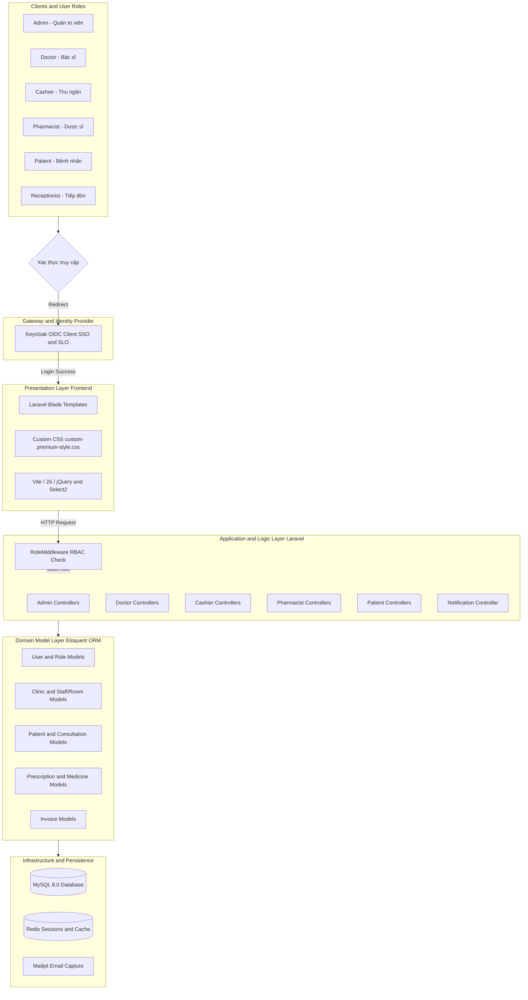
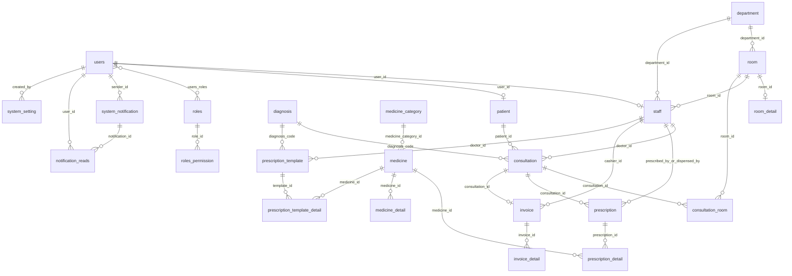
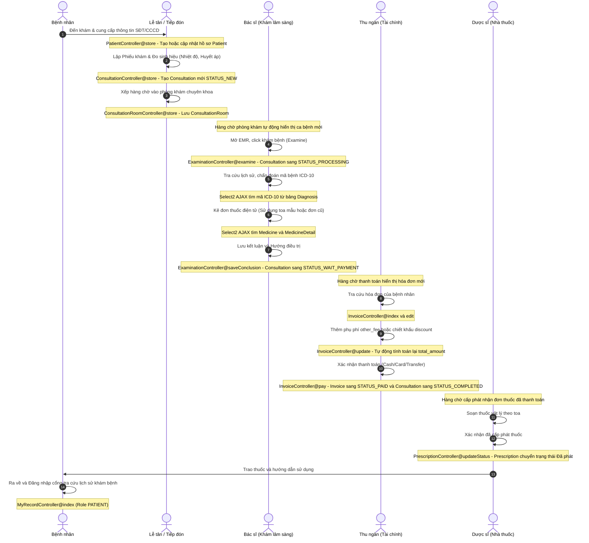

# Sơ đồ Kiến trúc Hệ thống & Cơ sở dữ liệu ERP (QLPK)

Tài liệu này chứa các sơ đồ kiến trúc hệ thống, sơ đồ quan hệ thực thể (ERD), ma trận phân quyền (RBAC) và quy trình nghiệp vụ lâm sàng dưới dạng mã **Mermaid.js** đã được tinh chỉnh để **tương thích hoàn toàn với Draw.io (độ ổn định tối đa khi import)**.

> [!TIP]
> **Cách import vào Draw.io:**
> 1. Trên thanh công cụ Draw.io, chọn **Arrange > Insert > Advanced > Mermaid...**
> 2. Copy đoạn mã Mermaid tương ứng từ tài liệu này (chọn Phần 1 hoặc Phần 3) và paste vào khung nhập liệu.
> 3. Chọn **Insert** để Draw.io tự động vẽ các khối có thể chỉnh sửa trực tiếp.
> 4. *Lưu ý:* Draw.io không hỗ trợ biểu đồ ERD (Phần 2) bằng công cụ import này. Với ERD, vui lòng xem trực tiếp trên GitHub/VS Code hoặc import dưới dạng SQL Schema DDL.

---

## 1. Kiến trúc Phân lớp Hệ thống (System Architecture Layers)

Sơ đồ phân lớp công nghệ của phòng khám từ Client đến hạ tầng cơ sở dữ liệu. Sử dụng định dạng đơn giản không dùng dấu ngoặc kép bên trong mô tả nút để tránh lỗi parser của Draw.io:

---

## 2. Sơ đồ Quan hệ Cơ sở dữ liệu (ERD)

Sơ đồ ERD thể hiện quan hệ thực thể của 23 Eloquent Models. Xem tốt nhất bằng trình đọc Markdown của VS Code hoặc GitHub:

---

## 3. Quy trình Vận hành Lâm sàng End-to-End (Workflow)

Sơ đồ tuần tự chuẩn hóa luồng tiếp nhận, chẩn đoán, thu phí và cấp phát thuốc của QLPK. Đã loại bỏ tất cả các thẻ HTML ` ` trong phần Note để đảm bảo Draw.io nhận diện và vẽ thành công:

---

## 4. Ma trận Phân quyền & Vai trò (RBAC Matrix)

| Vai trò | Mã Code (Role) | Mô tả phạm vi quyền hạn chính |
| :--- | :--- | :--- |
| **Quản trị viên** | `ADMIN` | Toàn quyền cấu hình hệ thống, quản lý Staff, cấu hình phòng/khoa, import Excel cho ICD-10 và Danh mục Thuốc gốc, xem Dashboard tổng số liệu doanh thu. |
| **Tiếp đón** | `RECEPTIONIST` | Tiếp nhận hồ sơ bệnh nhân mới/cũ, tạo Phiếu khám ban đầu, nhập chỉ số sinh hiệu, xếp hàng phân buồng khám vào phòng bác sĩ chuyên khoa. |
| **Bác sĩ khám** | `DOCTOR` | Xem hàng chờ khám phòng mình, thực hiện chẩn đoán EMR, nhập mã bệnh ICD-10, kê đơn thuốc và lưu kết luận điều trị, quản lý toa mẫu cá nhân. |
| **Thu ngân** | `CASHIER` | Tiếp nhận hàng chờ thanh toán của bệnh nhân, nhập phụ thu/chiết khấu, in biên nhận tài chính in ấn và bấm xác nhận hoàn tất thanh toán. |
| **Dược sĩ** | `PHARMACIST` | Xem hàng chờ cấp đơn thuốc đã đóng tiền, chuẩn bị thuốc vật lý, bấm xác nhận đã cấp phát thuốc để giải phóng đơn thuốc khỏi hàng đợi. |
| **Bệnh nhân** | `PATIENT` | Tự đăng nhập cổng tra cứu để xem toàn bộ lịch sử bệnh án cá nhân, chẩn đoán lâm sàng của bác sĩ và hướng dẫn sử dụng các đơn thuốc cũ. |
